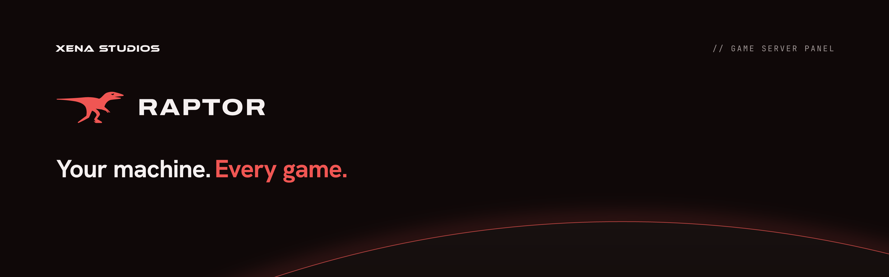

**Your machine. Every game. Run one command on any Linux box you own or rent, pick from 350+ games and apps, and manage it all from the web, with no panel to host.**

<!-- Badges: Xena's, from xena-studios/brand (docs/badges.md there says which go where). -->

Raptor is a hosted game server management platform. You bring your own Linux machine (a dedicated server, a VPS, a spare box at home), run a single install command, and it links to the web panel at [raptorpanel.net](https://raptorpanel.net). From there you run game servers, Discord bots, voice servers, and self-hosted apps, from Raptor's own [library of tested eggs](https://raptorpanel.net/library/) or any Pterodactyl egg.

What's built in, that other panels leave to add-ons: plugins, mods, and modpacks from Modrinth, Hangar, CurseForge, FTB, Technic, uMod, and the Factorio mod portal, and Steam Workshop items; Minecraft's players, worlds, versions, and settings as forms; incremental, encrypted backups; six database engines with a browser for each; private networks and a firewall; alerts; and dangerous actions signed with your passkey and checked by your machine. Your servers, schedules, and backups keep running if the Panel is down.

Coming from Pterodactyl? `raptor import pterodactyl` moves servers over on the same machine. How Raptor compares with Pterodactyl, Pelican, Calagopus, and the rest: [every panel, compared](https://raptorpanel.net/compare/).

> **Status:** early access, running in production at [raptorpanel.net](https://raptorpanel.net) with no uptime promise yet. What's left before launch is in the [roadmap](docs/ROADMAP.md), and what's new each week is at [raptorpanel.net/changelog](https://raptorpanel.net/changelog/).

## Components

| Component | What it is | Where it runs |
|---|---|---|
| **Panel** | Web app + API. Users, orgs, auth, billing, node enrollment. | Raptor's infrastructure (SaaS only) |
| **Wings** | The daemon. Runs servers in Docker, schedules, backups, SFTP, crash recovery. Keeps working when the Panel is unreachable. | The owner's Linux box |
| **`raptor` CLI** | Local tool for keeping servers up: status, power, console, logs, backups and restores, `doctor`. | The owner's Linux box |

## Documentation

**Running Raptor?** The guides are at [docs.raptorpanel.net](https://docs.raptorpanel.net) (`docs-site/`), and help is on [Discord](https://discord.gg/HyUa3sRpeN). The documents below are for contributors: how Raptor is built, and why.

- [Product outline](docs/PRODUCT.md): what Raptor is and who it's for
- [Architecture](docs/ARCHITECTURE.md): how the pieces fit together
- [Wings](docs/WINGS.md): the daemon in detail
- [Panel](docs/PANEL.md): the SaaS control plane
- [Design](docs/DESIGN.md): the web app's design system
- [Deploying](docs/DEPLOY.md): running the Panel's servers
- [Servers](docs/SERVERS.md): server model, states, ports, console, crash policy, deletion
- [Egg compatibility](docs/EGGS.md): Pterodactyl egg support
- [Networks](docs/NETWORKS.md): keeping servers on one node apart
- [Databases](docs/DATABASES.md): managed databases on owners' nodes
- [Security model](docs/SECURITY-MODEL.md): threat model and security rules
- [Reliability and performance](docs/RELIABILITY.md): requirements and how we meet them
- [Decisions log](docs/DECISIONS.md): every locked decision and why
- [Roadmap](docs/ROADMAP.md)

## Licence

Raptor is licensed under the [GNU Affero General Public License v3.0](LICENSE). Contributions are accepted under the [Developer Certificate of Origin](CONTRIBUTING.md#developer-certificate-of-origin-dco).
